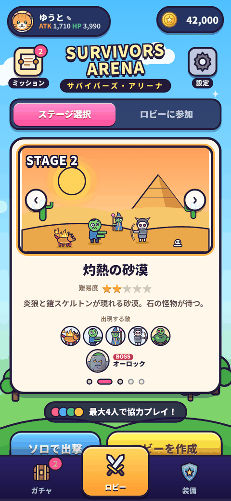
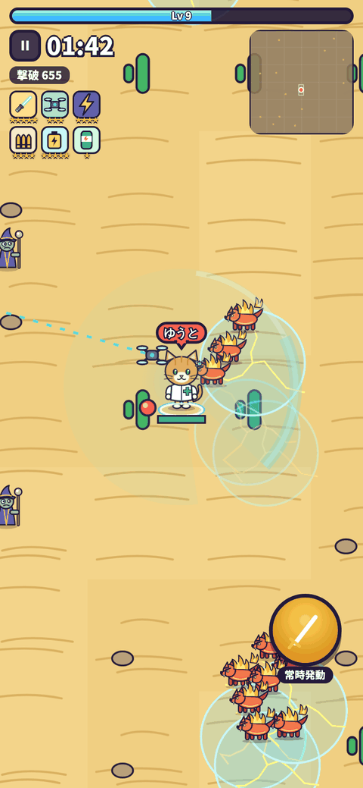
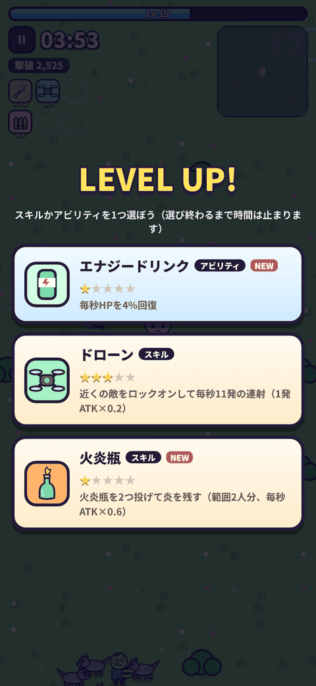
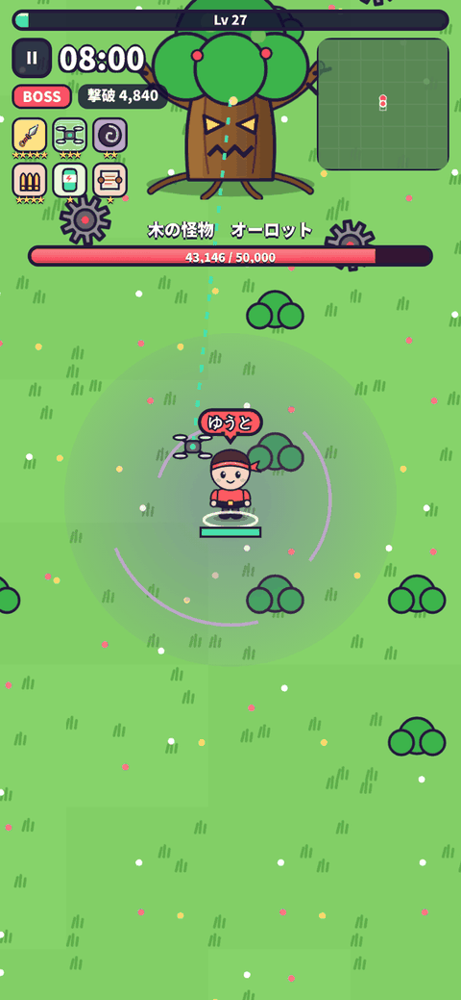
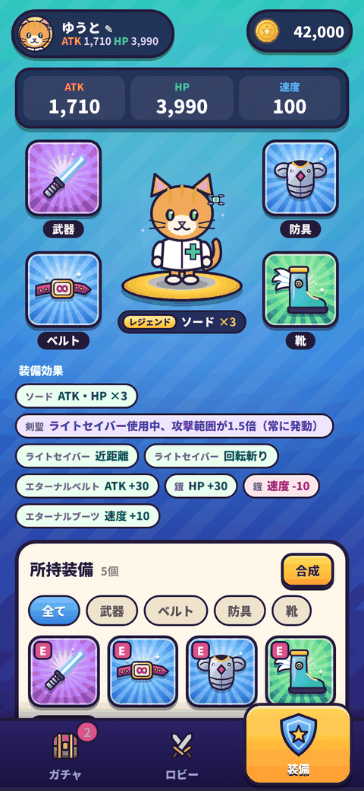
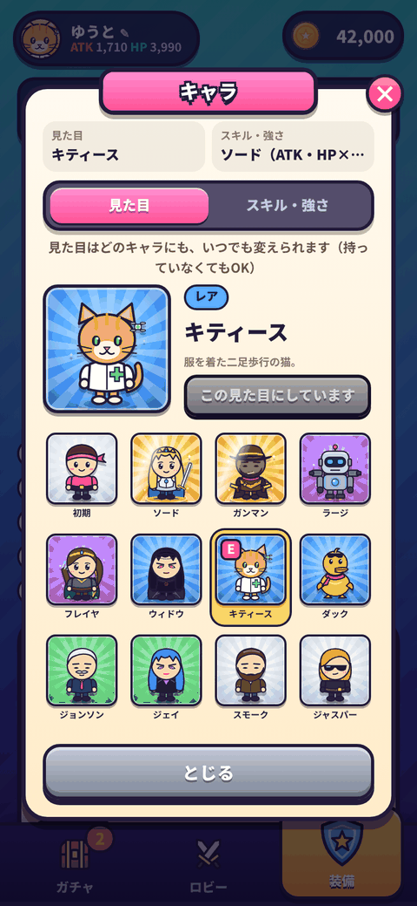
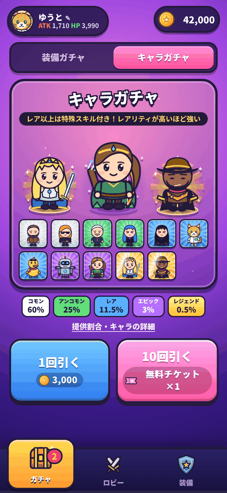
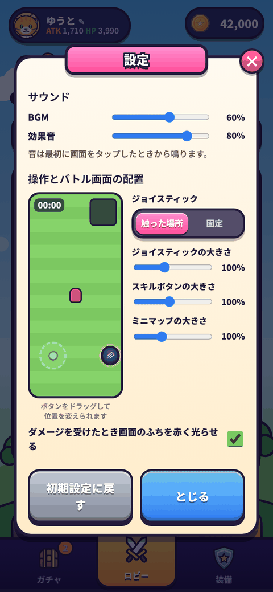

# SURVIVORS ARENA（サバイバーズ・アリーナ）

最大4人で協力プレイできる、見下ろし型のサバイバー系アクションゲームです。
ブラウザだけで動き、ビルド作業もサーバーも不要なので、GitHub Pages にそのまま公開できます。

<p align="center">
  
  
  
  
</p>
<p align="center">
  
  
  
  
</p>

## 遊び方

### はじめの流れ
1. はじめて開くと引き継ぎコードを発行し、プレゼントとして **装備ガチャ10連無料チケット** を1枚もらえます（最初のコインは 0）
2. チケットで装備ガチャを引いて装備をそろえ、ステージ1へ
   - リセマラ防止のため、**ステージ1をクリアするまでは コモン・アンコモン・レア だけ** が出ます（60% / 25% / 15%）
3. **ステージ1クリア**：装備ガチャでエピック・レジェンドも出るようになり、ステージ2が解放
4. **ステージ2クリア**：キャラガチャが解放され、**キャラガチャ10連無料チケット** を1枚もらえます
5. あとはミッションのコインでガチャを引き、装備とキャラを育てて次のステージへ

### ロビー
- **ステージ選択**：ステージは前のステージをクリアすると順番に解放されます。「ソロで出撃」または「ロビーを作成」
- **ロビーに参加**：ホストに教えてもらった **ロビーID（6桁）** と **パスワード** で参加（最大4人）
- 待機室ではホストだけがステージを選べます。**ホストが解放したステージなら、まだクリアしていない人も参加できます**
- 全員が「準備OK」になると出撃できます
- ステージ選択には出てくる雑魚敵が並び、その1行下にボスが表示されます
- 左上の名前をタップすると **ユーザーネームの変更** と **引き継ぎコードの確認** ができます
- 右上の歯車から **設定**（下の「設定」）
- **ミッション**：ステージを1回クリアするたびに 3,000 コイン、敵を100体倒すごとに 300 コイン
- **難易度**：1人討伐は1倍、パーティー討伐（2人以上）は **3倍**（狼以外の雑魚敵と中ボスの体力が3倍。ボスは下の表）

### 設定
- BGM・効果音の音量（音はすべてプログラムで鳴らしているので、音声ファイルはありません）
- ジョイスティック：「触った場所」に出るか「固定」か、大きさ、固定のときの位置
- スキルボタンの大きさと位置（設定画面のミニ画面でボタンをドラッグ）
- ミニマップの大きさ、ダメージを受けたとき画面のふちを赤く光らせるか
- 設定はこの端末だけに保存されます（引き継ぎコードでは移りません）。バトル中もメニューから開けます

### 装備とガチャ
- 装備ガチャは 1回 3,000 / 10回 30,000 コイン。確率はコモン60% / アンコモン25% / レア11.5% / エピック3% / レジェンド0.5%
  （ステージ1をクリアするまではコモン・アンコモン・レアだけ）
- ガチャの中身は上から **武器**（クナイ・ショットガン・ライトセイバー・リボルバー）、**防具**（鎧・レザーアーマー）、**ベルト**（ステラベルト・エターナルベルト）、**靴**（エターナルブーツ・フロストブーツ）
- 武器とベルトで ATK、防具と靴で HP が上がります（コモン60 / アンコモン120 / レア180 / エピック260 / レジェンド350）。持っている装備だけ装着できます

### 引き継ぎコード
- はじめて開いたときに **プレイヤーID（8文字）と4桁のパスワード** を発行します
- 「保存しないとデータが消える可能性があります」と表示し、保存したことにチェックするまで先に進めません
- データは自動でクラウドに保存されます。機種変更などのときは「別の端末のデータを引き継ぐ」から ID とパスワードを入力
- 使うには Firebase の設定が必要です（下の「引き継ぎ（Firebase）の設定」）。未設定のときはテストモードになり、同じブラウザの中でしか引き継げません

### バトル
- 上から見下ろした視点で自分のキャラを操作します。**画面をドラッグ**（PCは **WASD / 矢印キー**）で移動
- 武器は自動で一番近い敵を狙って攻撃します（クナイは追尾して必中）
- 右上に **ミニマップ**。仲間には名前のピンが付き、画面外の仲間は画面の端に矢印で表示されます
- マップはとても広く（9,000 × 9,000）、ステージごとに出てくる敵が違います

| 時間 | できごと |
| --- | --- |
| 0:00〜 | 敵がどんどん増えていく |
| 2:30 / 5:30 | **ラッシュ**：中ボスの30秒前に敵の群れが一気に突撃 |
| 3:00 / 6:00 | 中ボスが出現（ステージ1〜3は「でかいゾンビ」、4・5は「エリートゾンビ」） |
| 8:00 | タイマーが止まり、**ボスの祭壇** が出現 |
| 全員が祭壇に入る | 5秒カウントダウン → ボス出現と同時にボス以外の敵は消える |
| ボスを倒す | ステージクリア |
| 全員がダウン | ゲームオーバー |

- **ダンボール**：最初にマップに10個、その後1分ごとに3個増えます。壊すと 1/8 の確率で回復アイテム（最大HPの30%回復）
- **ダウンと復活**：HPが0になるとその場に墓が立ちます。別のプレイヤーが3秒そばに留まると復活（HP50%）
- **特殊スキル**：レア以上のキャラは右下の丸いボタンで特殊スキルを使えます（PCはスペースキー）
- **経験値はパーティー全員で共有**。レベルが上がると全員がそれぞれ3つの候補から1つ選び、全員が選び終わるまで時間が止まります
- スキル・アビリティはその試合限り。試合が終わればリセットされます

### スキル（3枠：武器 + 2つ）

武器は最初から★1。取得するたびに★が上がり、最大★5です。装備している武器以外の武器スキルは出ません。

| スキル | 効果 | ★が上がると |
| --- | --- | --- |
| クナイ | 1秒ごとにクナイを投げる。追尾して必中（ATK×1.0） | クナイが1本ずつ増える |
| ショットガン | 1.5秒ごとに散弾。全弾命中でATK×2.0 | ダメージ×1.1、間隔-0.2秒 |
| ライトセイバー | 1秒ごとに自分のまわり（キャラ3体分）を回転斬り（ATK×1.0） | ダメージ×1.2、間隔-0.1秒 |
| リボルバー | 0.5秒ごとに近くの敵1体を撃ち抜く（ATK×1.0） | ダメージ×1.2、間隔-0.05秒 |
| ディフェンサー | 自分の周りを黄色い歯車がゆっくり回る（ATK×1.0）。★1で2つ | 歯車が1つずつ増える |
| ドローン | 近くの敵1体をロックオンして連射。毎秒5発、1発ATK×0.2 | 毎秒+3発 |
| 雷発生機 | 雷を落とし、5秒間電気が残る（電気は毎秒ATK×0.6、プレイヤー3人分の円） | 雷が1本ずつ増える |
| サッカーボール | 画面の端で跳ね返るボール（ATK×2.0、プレイヤー1人分の大きさ） | 1人分大きく・速くなる |
| 火炎瓶 | 2本投げて炎を残す（毎秒ATK×0.6、プレイヤー2人分） | 範囲+1人分、ダメージ+0.2 |
| 重力発生機 | 周りの敵の移動速度を半分にし、毎秒ATK×0.2 | 遅くする量+10%、ダメージ+0.2 |

### アビリティ（3枠）

| アビリティ | ★1 | ★が上がるごとに |
| --- | --- | --- |
| エナジードリンク | 毎秒HP 4%回復 | +1% |
| 弾薬 | 攻撃力 +10% | +10% |
| エネルギー装置 | 攻撃速度 +10% | +10% |
| 防弾チョッキ | 受けるダメージ -10% | -10% |
| 巻物 | チーム全体の経験値 +10% | +10% |
| コイン獲得 | 試合後にコイン +300 | +300 |

枠が埋まると、レベルアップの候補には持っているスキル・アビリティだけが出ます。★5になったものは出ません。
（全部がMAXになったときは「HPを回復」が出ます）

### キャラ（キャラガチャ）

キャラガチャはステージ2をクリアすると解放されます。1回3,000・10回30,000コイン。
**出る確率**は装備ガチャと同じ（コモン60% / アンコモン25% / レア11.5% / エピック3% / レジェンド0.5%）で、
×1.2 などは出る確率ではなく、**そのキャラを使ったときの ATK・HP の増え方** です。

「装備」画面のキャラをタップすると、**見た目** と **スキル・強さ** を別々に選べます。
- **見た目**：持っていないキャラも含めて、いつでも好きなキャラに変えられます（ステージをクリアしていなくてもOK）
- **スキル・強さ**：手に入れたキャラから選びます。ATK・HP の倍率と特殊スキルはこちらで決まります
- 例：見た目はフレイヤ、スキルはソード
- レアリティが高いキャラほど、足元に光（レアは青、エピックは紫、レジェンドは金色の光線）が出て強そうに見えます

| レアリティ | ATK・HP | キャラ | 特殊スキル |
| --- | --- | --- | --- |
| コモン | ×1.2 | スモーク / ジャスパー | なし |
| アンコモン | ×1.5 | ジョンソン / ジェイ | なし |
| レア | ×1.8 | ウィドウ | 30秒ごと：10秒間すべての敵の移動速度 -10 |
| レア | ×1.8 | キティース（服を着た二足歩行の猫） | 常時：回復ドローンが自分のまわりを飛び、半径キャラ10体分の味方か自分の中で一番HPが少ない人に毎秒1発、最大HPの1%を回復 |
| レア | ×1.8 | ダック | 30秒ごと：5秒間自分の移動速度 +30% |
| エピック | ×2.2 | ラージ | 30秒ごと：3秒間無敵 |
| エピック | ×2.2 | フレイヤ | 60秒ごと：自分から一定範囲内の敵全員に矢を放つ（範囲はプレイヤー10体分、ATK×3） |
| レジェンド | ×3 | ソード | 常時：ライトセイバーの攻撃範囲1.5倍 |
| レジェンド | ×3 | ガンマン | 30秒ごと：8秒間武器の攻撃速度2倍 |

キティースの「一番HPが少ない人」は、最大HPに対する残りHPの割合で選びます。

### 合成

同じ装備（種類・レアリティ・合成段階が同じもの）を3つ集めると合成できます。装備の下の真ん中にマークが付きます。

| 段階 | 合成前から見た ATK/HP | 必要なもの |
| --- | --- | --- |
| ❶ | 2倍 | 同じ装備3つ |
| ❷ | 5倍 | ❶を3つ |
| ❸（最大） | 10倍。見た目が光り、まわりに稲妻が走る | ❷を3つ |

### 敵キャラ

ステージが1つ進むごとに、敵の攻撃力が **1.5倍** になります。
雑魚敵の体力もステージごとに上がる（ステージ1〜5で ×1 / ×7 / ×14 / ×23 / ×33）ので、
**そのステージに見合う装備を育てていないと、雑魚敵でもワンパンできません**。

| 敵 | 体力（ステージ1） | 攻撃力 | 特徴 |
| --- | --- | --- | --- |
| 狼 / 炎狼 / 氷狼 | 30 | 10 | 足が速く、大きな群れで来る。触れている間ダメージ。ステージ2は燃えている炎狼、ステージ3は凍った氷狼 |
| ゾンビ | 50 | 30 | 足が遅く、群れで来る。触れている間ダメージ |
| 魔法使いゾンビ | 30 | 30 | 遠距離の単発攻撃（3秒ごと）。弾の色はステージ2で赤、ステージ3で水色 |
| 鎧スケルトン | 80 | 42 | 遠距離の単発攻撃。足が遅い |
| でかいゾンビ（中ボス：ステージ1〜3） | 2,000 | 200 | 硬くて強い近距離攻撃。足は遅い |
| エリートゾンビ（中ボス：ステージ4・5） | 4,000 | 400 | でかいゾンビの2倍の強さ |

| ステージ | 出現する敵 | 中ボス | ボス | ボスの体力（1人） |
| --- | --- | --- | --- | --- |
| 1 はじまりの草原 | 狼・ゾンビ・魔法使いゾンビ | でかいゾンビ | オーロット（木の怪物）：遠距離攻撃＋回る歯車 | 135,000 |
| 2 灼熱の砂漠 | 炎狼・ゾンビ・魔法使いゾンビ・鎧スケルトン | でかいゾンビ | オーロック（石の怪物）：攻撃力400の石を投げる | 180,000 |
| 3 凍てつく雪原 | 氷狼・ゾンビ・魔法使いゾンビ・鎧スケルトン | でかいゾンビ | フロストゴーレム（氷の3方向弾＋歯車） | 230,000 |
| 4 怒れる火山 | 狼・ゾンビ・魔法使いゾンビ・鎧スケルトン | エリートゾンビ | イフリート（炎の5方向弾） | 520,000 |
| 5 月夜の廃墟都市 | 狼・ゾンビ・魔法使いゾンビ・鎧スケルトン | エリートゾンビ | ファントムキング（7方向弾＋歯車） | 760,000 |

- ボスは **1人で約30秒、パーティーで約50秒** かかる強さにしてあります（そのステージに見合う装備のとき）
- パーティーではボスの体力が **1人のときの体力 × 1.5 × 人数**（2人で3倍、3人で4.5倍、4人で6倍）になります
- ボスは動きません。画面上部に体力ゲージが表示されます
- ラッシュでは、ステージ1は狼、2は炎狼、3は氷狼とゾンビ、4・5はいろいろな敵が大量に突撃してきます

## 引き継ぎ（Firebase）の設定

引き継ぎコードでデータを別の端末に移すには、無料の [Firebase](https://console.firebase.google.com/) を使います（Spark プランで無料）。
設定は最初に1回だけです。

1. [Firebase コンソール](https://console.firebase.google.com/) で **プロジェクトを追加**（Google アナリティクスはオフで大丈夫です）
2. 左のメニュー **構築 → Authentication → 始める** を開き、ログイン方法で **メール / パスワード** を有効にする
   （プレイヤーIDとパスワードから内部用のアカウントを作るために使います。メールは送られません）
3. **構築 → Realtime Database → データベースを作成**。場所はどこでもOK（日本から遊ぶなら `asia-southeast1` がおすすめ）、**ロックモード** で開始
4. Realtime Database の **ルール** タブに下を貼り付けて **公開**（自分のデータだけ読み書きできるようにする設定です）
   ```json
   {
     "rules": {
       "saves": {
         "$uid": {
           ".read": "auth != null && auth.uid === $uid",
           ".write": "auth != null && auth.uid === $uid"
         }
       }
     }
   }
   ```
5. **プロジェクトの設定（歯車）→ 全般 → マイアプリ → ウェブ（`</>`）** でアプリを登録し、表示される `firebaseConfig` から
   `apiKey` と `databaseURL` を `js/config.js` の `CLOUD` に貼り付ける
   ```js
   CLOUD: {
     apiKey: 'AIza....',
     databaseURL: 'https://xxxx-default-rtdb.asia-southeast1.firebasedatabase.app',
     ...
   },
   ```
   ※ `apiKey` は公開しても大丈夫な値です（データは手順4のルールで守られます）

メモ
- パスワードは4桁なので、ID を知っている人が総当たりすれば当てられる可能性があります。Firebase は失敗が続くと一時的にログインを止めますが、大事なデータを守る仕組みではありません
- 同じ ID を2台で同時に使うと、あとから保存した方のデータが残ります
- 引き継ぎコードは左上の名前をタップするといつでも確認できます

## GitHub Pages で公開する

1. GitHub で新しいリポジトリを作り、このフォルダの中身をすべてアップロードします
   （`index.html` がリポジトリの一番上にある状態にしてください）
2. リポジトリの **Settings → Pages** を開きます
3. **Build and deployment** の Source を **Deploy from a branch** にし、
   Branch を **main** / **/(root)** にして Save
4. 1〜2分後、`https://<ユーザー名>.github.io/<リポジトリ名>/` で遊べます

## 手元で動かす

`index.html` をダブルクリックするだけでも動きます。
ローカルサーバーで開く場合は、どちらかを実行して `http://localhost:8000` を開いてください。

```bash
python3 -m http.server 8000
# または
npx serve .
```

## マルチプレイの仕組み

| モード | 内容 |
| --- | --- |
| オンライン（標準） | [PeerJS](https://peerjs.com/)（WebRTC）で端末どうしを直接つなぎます。PeerJS の無料サーバーを接続の仲介に使うので、自分でサーバーを用意する必要はありません |
| ローカル | 同じブラウザのタブどうしで通信します。URL の最後に `?net=local` を付けると使えます。タブを2つ以上開けば1台で協力プレイのテストができます |

- バトル中は **ホストの端末が敵・スキル・経験値などをすべて計算** し、1秒に12回、全員に状態を送ります。ゲストは自分の位置を1秒に20回ホストへ送ります
- **ホストがアプリを閉じたり、別のアプリに切り替えたりすると全員のゲームが止まります**。ホストは画面を開いたままにしてください
- オンライン通信が読み込めない時（オフラインなど）は、自動でローカルモードに切り替わります
- PeerJS の無料サーバーは混雑することがあります。安定させたい場合は自分の PeerServer を立てて、`js/config.js` の `NET.PEER_OPTIONS` に `{ host, port, path, secure }` を設定してください
- 学校や会社のネットワークなど、WebRTC が制限された環境ではつながらないことがあります

## ファイル構成

```
.
├── index.html                 画面の骨組み
├── css/style.css              見た目（カラフルなゲーム風UI）
├── js/
│   ├── config.js              ★ロビー・ガチャ・装備の設定（確率・コイン・装備の補正・ステージ）
│   ├── state.js               セーブデータ（コイン・所持装備・ミッション）
│   ├── art.js                 ロビー・装備のイラスト（SVG）
│   ├── charArt.js             キャラ11体・レアリティの光・ダンボール・特殊スキルの絵（SVG）
│   ├── ui.js                  トースト・モーダル・装備カード
│   ├── sound.js               効果音とBGM（WebAudio で鳴らす。音声ファイルなし）
│   ├── settings.js            設定（音量・ボタンの大きさと配置）
│   ├── cloud.js               引き継ぎコード（Firebase）
│   ├── net.js                 ロビー通信（PeerJS / ローカル）
│   ├── main.js                起動処理・上のバー・下のバー
│   ├── screens/
│   │   ├── lobby.js           ロビー（ステージ選択 / ロビーに参加 / 待機室）
│   │   ├── gacha.js           ガチャ
│   │   ├── equip.js           装備
│   │   └── mission.js         ミッション
│   └── game/
│       ├── gameConfig.js      ★バトルの設定（敵・ボス・スキル・経験値・ミッション報酬）
│       ├── gameArt.js         敵・ボス・スキルのイラスト（SVG）
│       ├── sim.js             バトルの計算（ホストの端末で動く）
│       ├── render.js          バトル画面の描画（Canvas）
│       └── game.js            操作・HUD・通信・レベルアップ・結果画面
├── assets/favicon.svg
└── docs/screenshots/          README 用の画像
```

## 調整したい時

| 変えたいもの | 場所 |
| --- | --- |
| ゲーム名・最初のコイン・ガチャの値段・確率 | `js/config.js` |
| 最初にもらえる無料チケット | `js/config.js` の `START_TICKETS` |
| 最初に出るレアリティ（リセマラ防止） | `js/config.js` の `EARLY_RARITIES` / `FULL_RARITY_UNLOCK` |
| キャラガチャが解放されるステージ | `js/config.js` の `CHAR_TICKET_STAGE`（0 から数えるので 1 = ステージ2） |
| ガチャの中身の並び順 | `js/config.js` の `GACHA_ORDER` |
| 装備の補正・効果 | `js/config.js` の `ITEMS` |
| 試合時間・中ボスの時間・祭壇 | `js/game/gameConfig.js` の `MATCH_SECONDS` / `MIDBOSS_TIMES` / `ALTAR` |
| 敵の強さ・出てくる敵 | `ENEMIES` / `STAGE_ENEMIES` / `STAGE_ATK_MULT` |
| 敵の数 | `SPAWN` / `MAX_ENEMIES` |
| レベルの上がりやすさ | `XP` |
| スキルの数値 | `SKILL_PARAMS` |
| ボスの体力 | `BOSSES` の `hp` |
| 難易度（1人 / パーティー） | `DIFFICULTY` / `BOSS_PARTY` / `PARTY` |
| ステージごとの雑魚の硬さ | `STAGE_HP_MULT` |
| 中ボスの種類 | `STAGE_ENEMIES` の `midboss` |
| ラッシュ | `RUSH` / `STAGE_ENEMIES` の `rush` |
| ダンボール・回復アイテム | `BOXES` |
| キャラの倍率・特殊スキル | `js/config.js` の `CHAR_MULT` / `CHARACTERS` |
| 合成の倍率 | `js/config.js` の `FUSION` |
| ミッション報酬 | `MISSIONS` |

### バランスについて（自動プレイで測定した目安）

各ステージで想定している装備（装備画面に出る ATK・HP。キャラの倍率込み）

| ステージ | ATK | HP | だいたいの状態 |
| --- | --- | --- | --- |
| 1 | 300 | 1,150 | 最初の無料10連で引いた装備 |
| 2 | 420 | 1,350 | 少しガチャを回して、レアがそろってきた |
| 3 | 850 | 2,500 | キャラガチャで手に入れたキャラを使う |
| 4 | 1,400 | 3,400 | エピック装備・エピック以上のキャラ |
| 5 | 2,000 | 4,500 | 合成やレジェンドが混ざってくる |

- この装備のとき、ボスは1人で約25〜35秒、パーティーで約45〜60秒で倒せました
- 装備が足りないと雑魚敵を1発で倒せず、ラッシュや遠距離攻撃で倒されやすくなります（例：ステージ2の装備でステージ3に行くと、ほとんどクリアできません）
- 1人プレイで8分までに **Lv 20〜28** 前後。**巻物を★5** にするとスキル全MAXに届きやすくなります
- 中ボスの体力は表の値 × ステージの倍率 × 3（`MIDBOSS_HP_SCALE`）× 難易度
- 人数が増えると敵の数と必要経験値も増えます（`PARTY`。経験値は全員で共有）
- 自動プレイ（ボット）で測った値なので、実際に遊んでみて `js/game/gameConfig.js` で調整してください

**テスト用のコインボタン**：`js/config.js` の `DEBUG_COIN_BUTTON: true` にすると、コイン横に＋ボタン（押すと 30,000 コイン増える）が出ます。公開するときは `false` のままにしてください。

セーブデータはブラウザの localStorage に保存されます。リセットしたい時は、ブラウザの開発者ツールのコンソールで `DS.state.resetSave()` を実行してください。

## 今後のアイデア

- [x] 効果音・BGM
- [x] ステージクリアで次のステージを解放
- [x] 装備の合成
- [ ] 経験値の宝石を拾う仕組み

## ライセンス

[MIT License](LICENSE)
